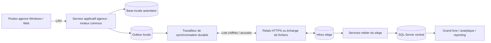

# GPT — état technique et trajectoire hybride Online/Offline First

Demande : https://github.com/piala00/YSFTEST/pull/20#issuecomment-6533810010
Source inspectée : 0af32c298f2300803ae0b68ecb3d68169430da5e ; corrections P0 proposées séparément.
Lecture du code et des transmissions, complétée par les tests existants. Aucun basculement d'architecture n'est
autorisé par ce document. Les éléments « cible » ci-dessous sont des propositions à éprouver, pas des fonctionnalités livrées.

## Composants déjà présents à conserver

| Responsabilité | Existant vérifié | Écart par rapport à la cible |
|---|---|---|
| Interface | Templates Django, bureau à fenêtres internes, ressources Bootstrap/Chart locales | Programme Windows compilé ouvrant une interface Web ; pas de client métier natif distinct ni de parcours PWA d'écriture hors ligne identifié. |
| Serveur métier | Django, modèles et services communs Commercial/Transport ; API DRF | Étendre la couverture des invariants et actions ; ne pas réimplémenter les calculs dans un client. |
| Droits | Middleware Web et DroitsMenusAPI, profils et droits de menus | Routes d'action comptable non rattachées au menu : anomalie P0 reproduite et correctif proposé. Revoir toute nouvelle route. |
| Données | erp/settings.py choisit SQLite (défaut), SQL Server ou PostgreSQL ; une société/dossier actif | Le siège SQL Server et les agences SQL Server sont une cible de déploiement, pas la configuration par défaut actuelle. |
| Windows/LAN | Inno Setup, WinSW/service.xml, serveur accessible sur LAN, rôle poste pointant le serveur | Les postes d'une agence partagent son serveur, pas un fichier SQLite indépendant chacun. |
| Miroir | Commande miroir, alias distinct et tâche périodique | Copie unidirectionnelle de base, à distinguer des échanges métier multi-agences. Aucun multi-maître par copie de tables. |
| Outbox | Evenement : UUID, séquence unique, objet, révision, date, auteur et payload | Durabilité des faits déjà en base ; atomicité de validation manuelle à corriger dans le lot P0. |
| Inbox/lots | LotRecu, EvenementRecu, dédoublonnage site/UUID, contrôles de version/société/destination, conflits et attentes | Distinguer réception et application effective ; ne pas considérer tous les reçus comme intégrés. |
| Transport des lots | HMAC-SHA256, enveloppe AES-GCM, relais HTTP ou dossier partagé ; échecs repris au prochain passage | Exécution périodique dans le processus serveur, pas encore un service de synchronisation autonome distinct. |
| Corrections agence | DemandeCorrection, réponse, extourne et remontée des corrections | Conserver la règle : le siège ne réécrit pas les comptes de l'agence. |
| Sièges | Verrou du Depart, contrôle des tronçons occupés, refus de modification d'une copie reçue | Protection dans le même serveur/base ; pas un protocole de quotas de sièges entre serveurs déconnectés. |
| Stocks | StockDepot, écritures/mouvements, verrous article et contrôle du disponible | Un paramètre peut autoriser le stock négatif : préciser la politique cible sans modifier la production en silence. |
| Comptabilité | Ecriture/LigneEcriture validées comme source générale et analytique | SN/SMT existe au niveau Societe ; le rattachement par exercice et les règles complètes restent à étudier/développer. |
| Analytique | plan_analytique.faits et non-affecté ; dimensions dérivées des lignes validées | Le code énumère 11 axes Transport ; la demande parle de dix plans. Clarifier le périmètre sans retirer ni additionner des axes. |
| Reprise et sauvegardes | Reprise encadrée, backups natifs/JSON complets, dossiers fictifs .erpsim | Mesurer reprise après panne et cohérence du site/curseur ; une sauvegarde seule ne prouve pas la reprise opérationnelle. |

Fichiers de référence : apps/core/{models,droits,poste,sauvegarde}.py, erp/settings.py,
apps/api/{views,serializers}.py, apps/echanges/{models,publication,lots,synchro,contrats,corrections}.py,
apps/transport/models.py, apps/commercial/models.py, apps/comptabilite/{models,services,plan_analytique}.py,
deploy/executable/erp_ohada.py, deploy/installateur/{erp_ohada.iss,service.xml}.

## Organisation évolutive proposée

La base autoritaire locale peut être le moteur déjà configuré pendant les essais ; le choix SQL Server par site
doit être dimensionné et éprouvé. Version d'Express/Standard, limites exactes et licences doivent être vérifiées
auprès de l'éditeur selon le volume mesuré, sans inventer un coût ou une capacité.
La séparation interface/API/application/base/services est retenue comme principe ; aucun besoin de Syracuse.
Un accès privé Tailscale/HTTPS peut compléter les accès distants ; le LAN doit fonctionner sans lui et sans Internet.

## Matrice des opérations en coupure

| Opération | Serveur d'agence disponible, Internet coupé | Poste indépendant sans serveur/autorité | Condition cible |
|---|---|---|---|
| Consultation locale | Oui selon droits | Cache éventuellement, daté et limité | Ne pas afficher un cache comme consolidation à jour. |
| Vente billet/siège | Oui pour départ dont l'agence est propriétaire | Non sans propriété/quota exclusif vérifié | L'Internet ne peut pas être nécessaire à une vente locale autorisée. |
| Correspondance/transit | Enregistrer le trajet et les engagements locaux possibles | Ne pas garantir un siège distant sans droit exclusif | Le placement distant ne doit pas devenir une seconde vente/recette. |
| Transvasement | Oui sur les départs/écritures sous autorité locale | Non en écriture autonome non coordonnée | Répartition traçable sans second encaissement. |
| Colis et incident | Oui pour les colis locaux ; événements en attente d'envoi | Consultation/constat limité à spécifier, pas d'indemnité autonome | L'indemnité garde autorisation, paiement et contrôles distincts. |
| Vente de marchandises | Oui sur stock local autoritaire disponible | Non sur copie de stock non coordonnée | Transferts par états explicites, pas augmentation arbitraire des stocks. |
| Caisse/règlement | Oui dans la caisse et la session locales autorisées | Non sans caisse exclusive et protocole défini | Une réception de lot ne rejoue pas l'encaissement. |
| Validation comptable | Oui dans le dossier/exercice local ouvert | Non dans une copie indépendante du grand livre | Publication atomique et validation unique. |
| Clôture | Locale sous droits et contrôles ; consolidation siège signalée provisoire | Non | Distinguer clôture locale, réception des faits et clôture consolidée. |
| Reporting siège | Derniers faits reçus avec date/état de synchronisation | Cache daté | Les agences non reçues restent visibles, sans faux total définitif. |
| Sauvegarde locale | Oui | Selon le dossier réellement détenu | Une coupure WAN ne désactive pas les sauvegardes du serveur local. |
| Échanges | Outbox conservée, reprise à reconnexion ou par fichiers | Pas de réplication aveugle d'une base copiée | Même fait dédoublonné, conflits explicites, ordre et dépendances contrôlés. |

Un quota de sièges ne doit pas être réattribué simplement parce qu'un délai réseau expire : un serveur déconnecté
pourrait encore vendre ses sièges. Libération/transfert de propriété exigent un protocole et une preuve explicites.
Cette politique cible n'ajoute pas de mode poste isolé aux binaires déjà livrés.

## Risques et priorités

| Priorité | Risque/constat | Traitement |
|---|---|---|
| P0 | Droits, validation/clôture périmées et atomicité pièce/outbox reproduits | Corriger et tester avant extension des ventes multi-sites. Voir GPT_AUDIT_P0_VALIDATION_2026-10-30.md. |
| P0 cible | Copies autonomes vendant le même siège ou le même stock | Autorité exclusive ; pas de mode isolé vendeur tant que le protocole n'est pas éprouvé. Le scénario multi-serveurs n'est pas validé par un verrou local. |
| P1 | Curseur sequence_integree avancé sur les reçus continus sans filtrer le statut appliqué | Distinguer accusé de réception durable et application métier ; conserver le suivi des attentes/rejets/conflits. Pas de suppression silencieuse de l'inbox. |
| P1 | Restauration ou clonage pouvant réutiliser identité de site et séquences | Plan de reprise, journal de génération et arrêt contrôlé de l'ancien serveur ; pas de deux producteurs actifs du même site. |
| P1 | Travailleur périodique lié au processus applicatif | Étudier un service distinct avec bail local, reprise, délais, état de santé et arrêt propre ; réutiliser le protocole existant. |
| P1 | Politique stock négatif configurable et cible « stock disponible » | Arbitrer les cas métier et le mode hors ligne avant règle nouvelle ; tester refus et transfert. |
| P1 | HTTP LAN par défaut et secrets de site en configuration/base | Préparer TLS/contrôles d'accès/ACL et sauvegardes protégées ; aucune exposition Internet ou protection au repos non vérifiée n'est affirmée ici. |
| P1 | SN/SMT global et historique d'exercice | Matrice réglementaire officielle puis paramétrage daté ; pas de conversion silencieuse d'archives clôturées. |
| P2 | Terminologie dix plans / onze axes, client natif / interface Web compilée | Nommer exactement l'existant et décider le périmètre, sans refonte automatique. |

## Migration proposée par étapes réversibles

1. Établir versions et preuves, sauvegardes/reprise dans des dossiers fictifs ; inventaire et corrections P0.
2. Tester le même schéma et le même moteur métier sur SQL Server par site ; isoler les sociétés et identités de site.
   Le miroir existant n'est pas un mécanisme multi-maître et ne remplace pas cette migration contrôlée.
3. Compléter les traces d'accusés, états d'application, conflits et santé ; éprouver la reprise sur incident du travailleur.
4. Formaliser propriété des départs/sièges, stocks et caisses ; limiter les postes isolés et tester les conflits.
5. Ajouter le référentiel par société/exercice après vérification réglementaire, avec reprise de l'origine historique.
6. Pilote sur sites fictifs puis dossier de basculement concret : sauvegarde, retour arrière, contrôles, critères,
   dimensionnement et responsabilités. Aucun passage en production sans autorisation explicite du propriétaire.

## Stratégie de tests et critères de sortie

- LAN opérationnel avec WAN coupé : saisie/print locaux, sauvegarde et outbox conservées.
- Coupure avant/après dépôt d'un lot et perte de réponse : zéro seconde vente/écriture, même fait reçu une fois.
- Lots doublés, désordonnés, incomplets, altérés, autre société/destination et site désactivé : refus/attente/conflit tracés.
- Deux caisses sur le même serveur : un siège/local-stock ne peut pas être vendu deux fois ; erreurs transitoires reprises.
- Deux agences sans coordination : vente hors propriété refusée ; quota/transfert à tester seulement après spécification.
- Panne entre validation et outbox : les deux sont persistés ou aucun ; tests de ce premier lot P0.
- Redémarrage du service, restauration de sauvegarde, deux producteurs d'un même site : protocole de récupération vérifié.
- Clôtures et rapports : lignes générales validées, auxiliaires/caisse/stock rapprochés, agences absentes signalées,
  système comptable et exercice d'origine préservés, aucun total additionnant deux plans.
- Essai mesuré à 250 départs/jour toutes agences : publier remplissage, durée, matériel et volumes ; le benchmark
  de #20 à 5 % ne prouve pas la capacité du mois complet en charge réelle.

Réutiliser les tests apps/echanges/tests*, test_security*, tests_synchro, tests_corrections, les scénarios de #20,
les contrôles de sauvegarde/dossiers et les workflows SQLite/SQL Server/Windows. La baseline 0af32c2 est verte
dans les sept jobs ; ces résultats ne prouvent pas les nouvelles capacités cibles non encore implémentées.
